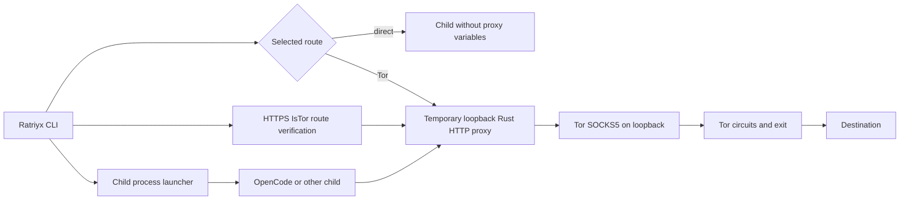

# Ratriyx architecture (0.4)

Ratriyx is one Rust CLI. Tor is a separate locally managed or user-provided SOCKS5 service. Normal routing uses an embedded HTTP-to-SOCKS5 adapter created and owned by the Ratriyx process.

## Lifecycle

On Windows, `run --mode tor` first checks Tor's SOCKS5 handshake. If absent, it may start the verified Ratriyx-owned Tor bundle and wait for bootstrap. For a newly started daemon it performs bounded temporary-route readiness checks; the final launch still requires its own IsTor=true result. The proxy listens on an OS-assigned loopback port until the routed child exits. Direct mode removes inherited proxy variables only for the child.

Windows uses a kill-on-close Job Object for routed child lifetime management. That tracks descendants when Windows accepts process assignment, but does not prevent network bypasses. Strict OS-enforced networking remains unimplemented; `run --strict` refuses rather than launching unprotected.

## Modules

| Module | Role |
|---|---|
| `interface::cli` | Parse commands and mode flags |
| `interface::diagnostics` | SOCKS5, direct IP, Tor IP, IsTor, app discovery and structured reports |
| `infrastructure::embedded_proxy` | Local HTTP and CONNECT requests forwarded over Tor SOCKS5 |
| `infrastructure::network` | Explicit direct and proxied HTTPS probes using bounded curl timeouts |
| `infrastructure::winmanaged` | Owned Windows Tor installation, startup and bootstrap waits |
| `infrastructure::job_windows` | Windows child Job Object lifetime |
| `infrastructure::runner` | Child environment, launch and exit code |
| `infrastructure::opencode` | Discover OpenCode and check supported arguments |
| `infrastructure::managed` | Managed installation ownership records |
| `application::commands` | Orchestrate setup, launch, diagnostics, recovery and legacy migration |

## Process boundaries

`run` changes proxy environment variables only for the child and descendants that inherit them. Shell commands `env` / `on` refuse Tor mode because generated variables cannot keep a temporary proxy alive. Optional desktop integration has a separate approval flow and changes current-user settings only when invoked explicitly. Legacy Privoxy flags, configuration and removal are preserved for compatibility; ordinary setup, status, doctor and Tor launches do not need it.

The IsTor probe verifies one HTTPS request through the intended proxy. Applications that ignore their proxy variables, open raw sockets, use custom DNS, or send traffic through an existing background service may use another route. Tor exit IPs can change, and application accounts or provider quotas are independent of route verification.

## Supported platforms

Windows: managed Tor bootstrap and native process launch implemented and subject to live network verification. Linux and WSL2: system Tor service and embedded proxy supported. macOS: embedded proxy supported; automatic managed Tor service start requires platform acceptance tests. No platform has strict OS isolation in the current release.