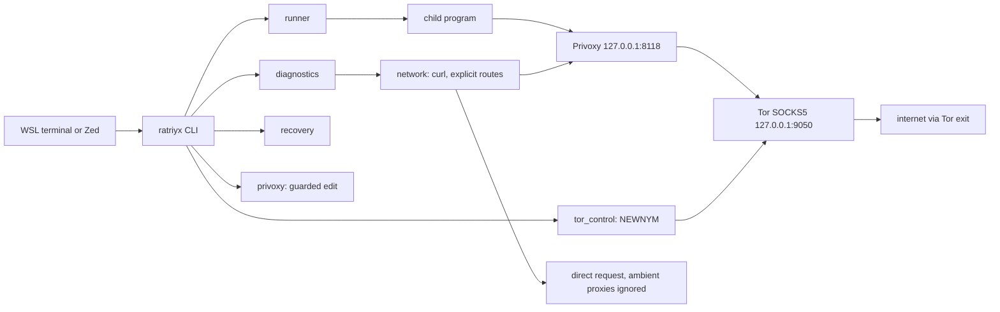

# Architecture

Ratriyx is one Rust binary with no third-party crates. It runs on Linux (WSL2 and plain Linux), native Windows, and macOS, driving Tor (SOCKS5) and Privoxy (HTTP proxy) that already exist on the machine.

## Process boundaries

Environment variables reach only the processes that receive them. Ratriyx changes:

| Process | What ratriyx changes |
|---|---|
| A child started by `ratriyx run` | Proxy variables for that child only. |
| The current shell | Only the lines `ratriyx env` or `ratriyx off` print, when you evaluate them. |
| Windows and PowerShell | Nothing. Use `WSLENV` deliberately if a Windows program must see a variable. |
| Zed and running OpenCode servers | Nothing. They keep the environment they started with. |
| Tor and Privoxy | Nothing by default. Changes are explicit, approved, and backed up. |

## Modules

| Module | Responsibility |
|---|---|
| `main` | Composition root: macros, module list, exit codes. No command logic. |
| `domain::route` | Pure route policy: `Mode`, `Verify`, proxy environment plan, launch decision and labels. No OS calls. |
| `domain::error` | Error types and exit codes. |
| `application::commands` | Dispatches each parsed command. `diagnose` (doctor, ip, status, rotate), `launch` (run, env, off), `proxy` (configure, restore), `maintenance` (recover, uninstall, config migrate). |
| `application::recovery` | Builds plans. The plan type has no stop action. Applies only approved service starts. |
| `application::maintenance` | `recover`, `uninstall` (+`--remove-managed` restore of recorded files/services), `config migrate`, managed `setup --install`. |
| `infrastructure::managed` | Versioned ownership record: which files/services Ratriyx created, with backups. Corrupt records stop managed work. |
| `interface::cli` | Parses arguments. Usage errors exit 2 before any platform check. |
| `interface::diagnostics` | Turns observations into PASS, WARN, FAIL, or NOT_TESTED. Renders text and JSON with redaction. |
| `interface::setup` | Read-only discovery and a list of steps for you to review. |
| `infrastructure::platform` | Detects OS, WSL generation, distro, init system; staged support levels; per-OS default paths, curl name, package managers. Unknown OS exits 3. |
| `infrastructure::service` | Allowlisted units and shared types. `systemd` runs `systemctl`/`journalctl` (Tor `tor@default`-then-`tor`); `sockets` parses `ss`/`netstat` listeners. Windows control is refused with a pointer to the PS scripts. |
| `infrastructure::config` | Strict TOML subset. Loopback only. Refuses TLS-off, fail-open, and non-loopback settings. |
| `infrastructure::network` | Runs curl with explicit routes: direct ignores ambient proxies; proxied uses Privoxy. Classifies failures. |
| `infrastructure::privoxy` | Detects the forwarding rule, refuses conflicts, appends the rule once with a backup, restores by hash. |
| `infrastructure::runner` | Starts the child process with a plan applied and maps its exit status. |
| `infrastructure::opencode` | Resolves the binary. Flags Windows interop launchers. Checks `--standalone` in help output. |
| `infrastructure::shell` | Prints quoted snippets for bash, zsh, fish, and PowerShell. Keeps a 0600 snapshot for `off`. |
| `infrastructure::tor_control` | Authenticates with the cookie file and sends one NEWNYM after a 10-second cooldown. |

## Verification sequence for a Tor-mode launch

1. The platform check passes (Linux, Windows, or macOS; WSL1 and untested setups are labelled conditional).
2. If the program is a Windows interop launcher, Tor mode refuses it unless `--allow-unverified` is given.
3. A proxied request to the verification endpoint must return `IsTor: true`.
4. Only then does the child start, with proxy variables set for that child.

A failure at any step stops the launch with exit 4. There is no direct fallback. `ip`, `status`, and a failed post-NEWNYM check exit 1 instead of 0.

## Platform support

| Platform | Status |
|---|---|
| Ubuntu 24.04 on WSL2 | Supported. Built, tested, and run live on the development machine (2026-10-15 evidence predates the cross-platform changes; re-verify). |
| Plain Linux with systemd | Implemented. Tor units discovered (`tor@default`, then `tor`). Acceptance NOT VERIFIED. |
| Plain Linux without systemd | Service checks report unknown. NOT VERIFIED. |
| Native Windows | Implemented (LOCALAPPDATA paths, `netstat` discovery). Runtime NOT VERIFIED. Service start/stop uses `scripts/windows/`. |
| macOS | Implemented (Homebrew prefixes). Runtime NOT VERIFIED. |
| Other operating systems | Refused, exit 3. |
